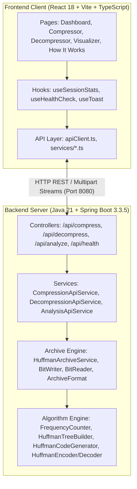
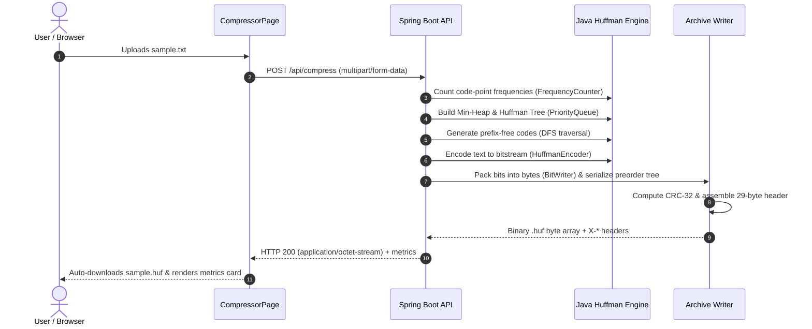

# Huffman Studio

A production-grade, university-level text compression platform powered by an authentic **Java 21** implementation of the **Huffman Coding Algorithm** and an interactive, modern **React 18 + TypeScript + Tailwind CSS** developer workspace.

---

## Table of Contents

- [Overview](#overview)
- [Key Features & Capabilities](#key-features--capabilities)
- [System Architecture](#system-architecture)
- [Algorithmic Pipeline & Workflow](#algorithmic-pipeline--workflow)
- [Binary `.huf` Archive Specification](#binary-huf-archive-specification)
- [Technology Stack](#technology-stack)
- [Project Structure](#project-structure)
- [Prerequisites](#prerequisites)
- [Installation & Quick Start](#installation--quick-start)
- [API Documentation](#api-documentation)
- [Testing & Quality Assurance](#testing--quality-assurance)
- [Viva & Technical Evaluation Guide](#viva--technical-evaluation-guide)
- [Known Limitations](#known-limitations)
- [Engineering Roadmap](#engineering-roadmap)
- [License](#license)

---

## Overview

**Huffman Studio** is engineered as a mathematically rigorous, fully realized demonstration of **Greedy Variable-Length Prefix Coding**. Unlike superficial academic demonstrations that merely simulate bit operations by saving ASCII string representations (e.g., storing `"0101"` as 4 bytes of text), Huffman Studio implements **authentic bit-level byte packing** and produces genuine binary `.huf` archive files.

The application features:
* **True Bit-Level Compression**: Pure Java bitstream input/output (`BitWriter` and `BitReader`) packing variable-length binary codes into standard 8-bit bytes.
* **Autonomous `.huf` Binary Container**: Standalone container format containing a 29-byte fixed header, preorder serialized tree topology, and packed bits — allowing independent decompression across machines without external frequency tables.
* **Decoupled Client-Server Model**: High-performance Java 21 Spring Boot backend orchestrating algorithm operations, exposed via RESTful JSON and streaming APIs to a reactive TypeScript/Tailwind frontend.
* **Interactive Visualizations**: Dynamic SVG binary tree renderer with pan, zoom, and root-to-leaf path tracing, plus frequency distribution analytics.
* **Lossless Round-Trip Guarantee**: Cryptographic-grade data integrity validation via 32-bit CRC (IEEE 802.3).

---

## Key Features & Capabilities

- **Real Binary Compression**: Generates self-contained `.huf` binary archives with versioned headers and preorder serialized tree topologies.
- **Full Unicode (UTF-8) Spectrum**: Complete support for multi-byte Unicode code points ($0\text{ to }0x10FFFF$), including Devanagari (Hindi), Chinese, Arabic, Japanese, emojis, and extended symbols.
- **Honest Statistics & Container Overhead**: Transparent reporting of exact byte savings, compression ratios, and clear educational notices when container overhead exceeds bit savings on small inputs.
- **CRC-32 Integrity Verification**: Embedded 32-bit checksums prevent data corruption, rejecting tampered files with HTTP `422 Unprocessable Entity`.
- **Interactive Tree Visualizer**: Real-time rendering of backend-generated Huffman trees with pan/zoom controls, search filters, and active bit-path highlighting on hover.
- **Session-Wide Analytics**: In-browser session tracker recording cumulative operations, files processed, and aggregate net bytes saved.
- **Developer-Grade UI**: Polished dark theme, collapsible sidebar navigation, step indicators, loading states, and toast notifications.

---

## System Architecture

Huffman Studio strictly enforces **Separation of Concerns (SoC)** and **Clean Layered Architecture**. The frontend handles user interaction and rendering, while the backend handles CPU-bound algorithmic computation and bitstream I/O.



---

## Algorithmic Pipeline & Workflow



---

## Binary `.huf` Archive Specification

Every `.huf` file generated by Huffman Studio is completely autonomous. The binary format contains:

```
+-----------------------------------------------------------------------------+
|                          HUF BINARY ARCHIVE LAYOUT                          |
|                                                                             |
|  +-------------------------+-------------------------+--------------------+ |
|  |   FIXED HEADER (29 B)   |   SERIALIZED TREE (Var) |   PAYLOAD (Var)    | |
|  +-------------------------+-------------------------+--------------------+ |
|  0                         29                        29+T                 End
+-----------------------------------------------------------------------------+
```

### Fixed Header Layout (29 Bytes)

| Offset | Size | Field Name | Type | Description |
| :--- | :--- | :--- | :--- | :--- |
| `0 .. 3` | 4 B | **Magic Signature** | ASCII | `"HUFN"` (`0x48 0x55 0x46 0x4E`). File identifier. |
| `4` | 1 B | **Format Version** | Byte | `0x01` (Version 1). |
| `5 .. 12` | 8 B | **Code Point Count** | Big-Endian Long | Number of Unicode characters in original text. |
| `13 .. 20` | 8 B | **Bit Count** | Big-Endian Long | Exact meaningful encoded bit count (ignores padding). |
| `21 .. 24` | 4 B | **Tree Node Count** | Big-Endian Int | Number of serialized tree nodes. |
| `25 .. 28` | 4 B | **CRC-32 Checksum** | Big-Endian Int | IEEE 802.3 checksum of original UTF-8 bytes. |

### Preorder Tree Serialization
- **Leaf Node (`0x01`)**: 1-byte marker followed by a 4-byte Unicode code point (int).
- **Internal Node (`0x00`)**: 1-byte marker followed by recursive serialization of left and right subtrees.

---

## Technology Stack

### Frontend Architecture
- **Framework**: React 18 with TypeScript 5.6
- **Build Tool**: Vite 5.4
- **Styling**: Tailwind CSS 3.4 with custom design tokens
- **Routing**: React Router DOM v6
- **Icons**: Lucide React
- **Data Visualization**: Recharts (symbol frequency distributions)
- **Typography**: Inter (UI font) & JetBrains Mono (monospace metrics & code tables)

### Backend Architecture
- **Runtime**: Java 21 (OpenJDK 21 LTS)
- **Framework**: Spring Boot 3.3.5
- **Build & Dependency Management**: Apache Maven & Maven Wrapper (`./mvnw`)
- **Web & Validation**: Spring Web MVC, Jakarta Bean Validation
- **Testing**: JUnit 5, Spring Boot Test, AssertJ

---

## Project Structure

```
Huffman-Studio/
├── backend/                        # Java 21 Spring Boot Backend
│   ├── .mvn/                       # Maven Wrapper configuration
│   ├── src/
│   │   ├── main/
│   │   │   ├── java/com/huffmanstudio/
│   │   │   │   ├── HuffmanStudioApplication.java
│   │   │   │   ├── algorithm/      # FrequencyCounter, TreeBuilder, CodeGenerator, Encoder, Decoder
│   │   │   │   ├── archive/        # ArchiveFormat, BitWriter, BitReader, ArchiveWriter, ArchiveReader
│   │   │   │   ├── config/         # CORS and Spring Web configuration
│   │   │   │   ├── controller/     # Compression, Decompression, Analysis, Health REST controllers
│   │   │   │   ├── dto/            # Data transfer contracts (TreeNodeDto, AnalysisResponse, etc.)
│   │   │   │   ├── exception/      # Centralized exception hierarchy (CorruptedArchiveException, etc.)
│   │   │   │   ├── model/          # HuffmanNode, HuffmanTree, ArchiveStatistics domain entities
│   │   │   │   └── service/        # CompressionApiService, DecompressionApiService, AnalysisApiService
│   │   │   └── resources/
│   │   │       └── application.yml # Port 8080 & multipart upload configuration
│   │   └── test/                   # Comprehensive JUnit 5 test suite (188 tests)
│   ├── mvnw                        # Unix Maven Wrapper script
│   ├── mvnw.cmd                    # Windows Maven Wrapper script
│   └── pom.xml                     # Maven project definition
├── frontend/                       # React 18 + TypeScript + Vite Frontend
│   ├── src/
│   │   ├── components/             # Reusable UI components & ui/ design library
│   │   │   └── ui/                 # Button, Badge, Toast, MetricCard, StepIndicator, EmptyState
│   │   ├── hooks/                  # Custom hooks: useSessionStats, useHealthCheck, useToast
│   │   ├── layouts/                # MainLayout.tsx & Sidebar.tsx navigation shell
│   │   ├── pages/                  # Dashboard, Compressor, Decompressor, Visualizer, HowItWorks
│   │   ├── services/               # apiClient, compressionService, decompressionService, etc.
│   │   ├── types/                  # TypeScript interfaces for API & compression contracts
│   │   ├── utils/                  # Byte formatting and date utilities
│   │   ├── App.tsx                 # Route hierarchy & ToastProvider wrapper
│   │   ├── index.css               # Design system CSS variables & scrollbar styles
│   │   └── main.tsx                # React DOM mount point
│   ├── index.html                  # HTML entry point
│   ├── package.json                # Frontend dependencies
│   ├── tailwind.config.js          # Design system color palette and animations
│   └── vite.config.ts              # Vite server & proxy configuration
├── docs/                           # Comprehensive Engineering Documentation
│   ├── API-REFERENCE.md            # REST API reference with cURL examples
│   ├── ARCHITECTURE.md             # In-depth architectural specification
│   ├── HUF-ARCHIVE-FORMAT.md       # Binary .huf specification and byte layout
│   ├── HUFFMAN-ALGORITHM.md        # Mathematical algorithm derivation
│   ├── PHASES.md                   # Systematic engineering roadmap
│   └── VIVA-GUIDE.md               # 29-topic university viva guide with 25 model Q&A
└── README.md                       # Main project documentation
```

---

## Prerequisites

Before running Huffman Studio, ensure you have:

1. **Java Development Kit (JDK) 21**:
   - Check version: `java -version`
   - Verified on OpenJDK 21 LTS.
   - On macOS:
     ```bash
     export JAVA_HOME="/opt/homebrew/opt/openjdk@21/libexec/openjdk.jdk/Contents/Home"
     export PATH="$JAVA_HOME/bin:$PATH"
     ```
2. **Node.js & npm**:
   - Node.js 18+ (tested on Node 20+)
   - Check versions: `node -v` and `npm -v`

---

## Installation & Quick Start

### 1. Clone the Repository
```bash
git clone https://github.com/heemanshu-021/Huffman-Studio.git
cd Huffman-Studio
```

### 2. Backend Setup & Run
Navigate to `backend/` and launch the Spring Boot server:
```bash
cd backend
./mvnw clean test
./mvnw spring-boot:run
```
The backend will start at `http://localhost:8080`.

Verify health check:
```bash
curl http://localhost:8080/api/health
```
Expected response:
```json
{
  "status": "UP",
  "message": "Huffman Studio Backend is operational",
  "version": "1.0.0"
}
```

### 3. Frontend Setup & Run
Open a second terminal window, navigate to `frontend/`, and start the development server:
```bash
cd frontend
npm install
npm run dev
```
Open your browser and navigate to `http://localhost:5173`.

---

## API Documentation

For the complete API contract, headers, error codes, and cURL examples, see [docs/API-REFERENCE.md](docs/API-REFERENCE.md).

### Core Endpoints

| Method | Endpoint | Consumes | Produces | Description |
| :--- | :--- | :--- | :--- | :--- |
| `GET` | `/api/health` | *None* | `application/json` | System health status & version probe |
| `POST` | `/api/compress` | `multipart/form-data` | `application/octet-stream` | Compresses `.txt` file into downloadable binary `.huf` with metrics in HTTP headers |
| `POST` | `/api/decompress` | `multipart/form-data` | `text/plain; charset=UTF-8` | Decompresses `.huf` archive into restored `.txt` text file |
| `POST` | `/api/analyze` | `application/json` \| `multipart/form-data` | `application/json` | Analyzes text or file for tree visualization, codes & frequencies |

---

## Testing & Quality Assurance

Huffman Studio features a multi-tiered testing strategy:

### 1. Backend Automated Tests (JUnit 5 & MockMvc)
```bash
cd backend
./mvnw clean test
```
- **188 automated tests** passing with 0 failures:
  - Unit tests: `FrequencyCounterTest`, `HuffmanTreeBuilderTest`, `HuffmanCodeGeneratorTest`, `HuffmanEncoderTest`, `HuffmanDecoderTest`.
  - Archive bitstream tests: `BitWriterReaderTest`, `HuffmanArchivePersistenceTest`.
  - Round-trip fidelity: `HuffmanArchiveRoundTripTest` (35 test cases asserting $100\%$ byte-for-byte fidelity across ASCII, Unicode, code files, and repetitive corpuses).
  - Defensive corruption tests: `HuffmanArchiveCorruptionTest` (corrupt magic, tampered CRC-32, truncated headers).
  - MockMvc Controller tests: `CompressionControllerTest`, `DecompressionControllerTest`, `AnalysisControllerTest`, `HealthControllerTest`.

### 2. Frontend Build Verification
```bash
cd frontend
npm run build
```
- `tsc -b && vite build` compiles cleanly with **0 TypeScript errors**.

### 3. End-to-End Live Round-Trip Verification
A dedicated automated E2E test suite (`scratch/e2e_test_suite.py`) verifies live HTTP round trips against a running server:
- Normal English prose ($100\%$ byte match)
- 50 KB large text file ($45.67\%$ space savings, $100\%$ byte match)
- Hindi Devanagari text ($100\%$ byte match)
- Chinese ideographs ($100\%$ byte match)
- Arabic script ($100\%$ byte match)
- Japanese kana/kanji ($100\%$ byte match)
- Emoji pictographs ($100\%$ byte match)
- Mixed multilingual text with symbols ($100\%$ byte match)
- Single character and repetitive sequences ($100\%$ byte match)
- Empty text file ($29\text{-byte}$ empty archive $\to$ restored $0\text{-byte}$ file)
- Corrupted archive diagnostics (bad magic $\to 422$, flipped bit CRC mismatch $\to 422$, truncated file $\to 422$, invalid file extension $\to 400$)

---

## Viva & Technical Evaluation Guide

For university examinations, project defense, and viva voce preparations, refer to the comprehensive guide:
📖 **[docs/VIVA-GUIDE.md](docs/VIVA-GUIDE.md)**

It covers:
- Core algorithm mechanics (Greedy choice, PriorityQueue min-heap, prefix-free codes).
- Authentic bit packing via `BitWriter` and `BitReader`.
- `.huf` binary layout and 29-byte fixed header offsets.
- Mathematical justification for container overhead on small inputs.
- Layered Java 21 Spring Boot architecture and DTO separation.
- **Top 25 frequently asked viva questions with model answers**.

---

## Known Limitations

1. **Two-Pass Static Compression**: Static Huffman coding requires scanning the text once to compute frequencies and once to encode. It does not perform one-pass streaming like Adaptive Huffman (FGK/Vitter).
2. **Container Format**: The Version 1 `.huf` format is designed for single text files; directory recursion or multi-file archiving is not supported in V1.
3. **High-Entropy Data**: Highly random data or pre-compressed formats (ZIP, JPEG) cannot be significantly compressed by Huffman coding alone due to Shannon entropy limits.

---

## Engineering Roadmap

- [x] **Phase 1: Foundation and Architecture** — Independent React and Spring Boot scaffolding, health check probe, CORS configuration.
- [x] **Phase 2: Huffman Core Algorithm Engine** — Pure Java Unicode frequency counting, Min-Heap PriorityQueue, tree construction, prefix code generation.
- [x] **Phase 3: Archive Specification & Binary File I/O** — `BitWriter`/`BitReader`, 29-byte `.huf` binary container, CRC-32 integrity validation.
- [x] **Phase 4: RESTful API Layer & Spring Integration** — Multipart upload/download endpoints, analysis API, centralized exception handling.
- [x] **Phase 5: Full-Stack Integration** — Connected React pages to real Java backend, session analytics, transparent container overhead notices.
- [x] **Phase 6: Premium UI/UX Transformation** — Modern developer workspace, collapsible sidebar, UI component library, SVG pan/zoom tree visualizer.
- [x] **Phase 7: Quality Assurance, Bug Fixes, Documentation & Release** — Inconsistency fixes (`HUFN` magic alignment), comprehensive viva guide, complete E2E testing, production package verification.

---

## License

This project is prepared for academic study, computer science university coursework, and portfolio demonstration.
Developed by [heemanshu-021](https://github.com/heemanshu-021).
